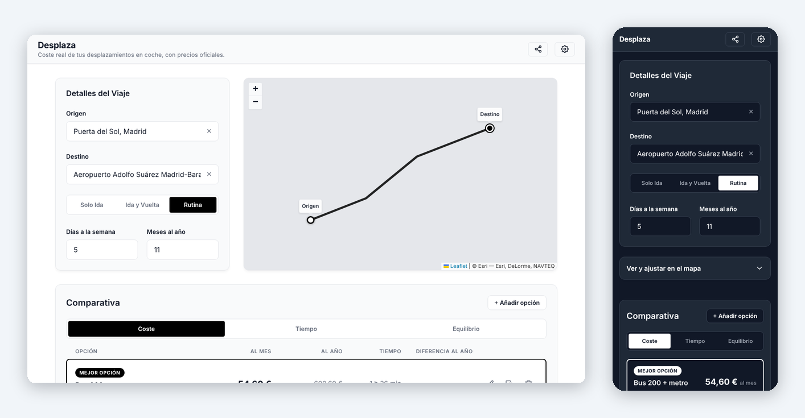

# Desplaza 🚗

*Read this in [English](README.md).*

Una aplicación web rápida y ligera que compara el coste y el tiempo reales de tus desplazamientos en España: varios coches, una moto, un coche eléctrico o el transporte público, sobre el mismo trayecto y con los precios oficiales del combustible de cada día.

Los costes se calculan en tu navegador, sin cuenta, sin cookies y sin analítica. Construida con **Vue 3 (Composition API)** y **TypeScript**.

**▶ [Pruébalo: desplaza.jnfire.dev/](https://desplaza.jnfire.dev/)**



## ✨ Características Principales
- **Compara opciones:** Añade hasta cinco formas de hacer el mismo trayecto, cada una con su propio nombre (por ejemplo, dos coches entre los que dudas), y ordénalas por coste, tiempo o un equilibrio de ambos con tu hora valorada en €/h. La mejor queda destacada, junto a lo que cuestan de más las demás al año.
- **Tipos de opción:** Coche o moto de combustión (precio del MITECO o manual), coche eléctrico (precio de la recarga en casa y en puntos públicos, y su reparto) y transporte público (abono mensual o billetes sueltos, tiempo puerta a puerta). A cualquier vehículo se le pueden sumar peajes, aparcamiento y desgaste.
- **Precios del combustible en tiempo real (MITECO):** Usa el precio medio del día en la provincia de origen, a partir de los datos abiertos oficiales del Ministerio para la Transición Ecológica y el Reto Demográfico. También puedes introducir tu propio precio.
- **Rutas y distancias:**
  - Búsqueda de direcciones con autocompletado mediante **Photon (OpenStreetMap)**.
  - Distancia por carretera, tiempo de conducción y trazado de la ruta mediante **OSRM (Open Source Routing Machine)**.
  - Los marcadores de origen y destino se pueden arrastrar en el mapa para ajustar la ruta.
- **Coste real del trayecto:** Coste por viaje, al mes y al año para trayectos de solo ida, ida y vuelta o recurrentes, con un recargo opcional por desgaste (0,08 €/km) que prorratea mantenimiento, neumáticos, seguro y depreciación.
- **Mapa interactivo:** **Leaflet** con mapas base de Esri en gris claro y oscuro que siguen el tema de la app.
- **Guardada y para compartir:** Tu comparativa se conserva en tu dispositivo entre visitas, y se puede compartir entera como enlace con la Web Share API o el portapapeles. Ningún servidor la almacena.
- **Privacidad:** Los costes se calculan en tu navegador. Sin cookies, sin analítica, sin registro y sin base de datos. La búsqueda de direcciones, las rutas y los mapas se piden a servicios de terceros (Photon, OSRM y Esri), y los precios del combustible al MITECO.
- **Soporte multi-idioma:** Interfaz completamente traducida a español, inglés, francés, alemán, italiano y portugués.
- **Diseño adaptativo:** Interfaz sobria y responsiva con tema claro, oscuro o del sistema.

## 🛠️ Tecnologías Utilizadas
- **Vue.js 3** (Composition API) + **Vite**
- **TypeScript** en modo estricto.
- **Vue-i18n** para el soporte multi-idioma.
- **Leaflet** para el mapa.
- **Vanilla CSS** con variables de diseño propias, sin frameworks de interfaz.
- **Vitest**, **ESLint** y **Prettier**, ejecutados en CI antes de cada despliegue.

## 📁 Estructura del Proyecto
El proyecto sigue una arquitectura modular y limpia que separa los clientes de servicios externos, las matemáticas puras de dominio y los componentes visuales. Puedes ver los detalles en [`docs/ARCHITECTURE-es.md`](docs/ARCHITECTURE-es.md).

## 🚀 Cómo ejecutarlo localmente

1. Clona el repositorio:
   ```sh
   git clone https://github.com/jnfire/desplaza.git
   cd desplaza
   ```

2. Instala las dependencias:
   ```sh
   npm install
   ```

3. Inicia el servidor de desarrollo:
   ```sh
   npm run dev
   ```

4. Ejecuta las comprobaciones (las mismas que el CI):
   ```sh
   npm run lint
   npm run format:check
   npm test
   ```

5. Comprueba los tipos y compila para producción:
   ```sh
   npm run build
   ```

## 📚 Documentación

- [Arquitectura](docs/ARCHITECTURE-es.md)
- [Sistema de diseño](docs/DESIGN-SYSTEM-es.md), compartido con las otras herramientas del portafolio
- [Roadmap](docs/ROADMAP-es.md)
- [Evolución](docs/evolution/README-es.md): cómo ha cambiado el proyecto, con capturas

## 🤝 Desarrollo

Diseñado y dirigido por [Javier Nicolás Pérez Mesa](https://github.com/jnfire): el producto, la arquitectura y las decisiones de diseño son suyos. Buena parte de la implementación se ha escrito con ayuda de IA ([Claude Code](https://claude.com/claude-code)), trabajando bajo su dirección y mediante pull requests que él revisa; los commits hechos así llevan un `Co-Authored-By`.

## 📄 Licencia
Copyright (C) 2026 Javier Nicolás Pérez Mesa.

Este proyecto es software libre publicado bajo la [Licencia Pública General Affero de GNU v3.0](LICENSE) (`AGPL-3.0-only`). Puedes usarlo, estudiarlo, modificarlo y compartirlo. Si distribuyes una versión modificada, o la ofreces a usuarios a través de una red, debes publicar su código fuente bajo la misma licencia.

---
Hecho por [Javier Nicolás Pérez Mesa](https://github.com/jnfire), 2026.
