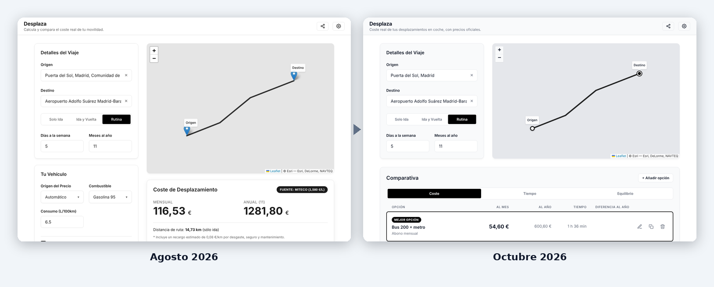

# Evolution

*Read this in [Spanish](README-es.md).*

How Desplaza went from its first commit to today, with the screenshots to show it.

## Timeline

| When | What happened |
| --- | --- |
| August 2026 | First commit and first public version: one car, MITECO fuel prices, a route on a map and the monthly and yearly cost. A branch with accessibility and usability work stayed unmerged. |
| October 2026 | Free software (AGPL-3.0), no Google Analytics or cookie banner, honest documentation of the third-party services, one design system shared with the other two tools and CI that gates every deploy. The accessibility branch was brought in: the address search became a keyboard-accessible combobox and the sources dialog a real dialog. |
| October 2026 | Comparison of several options on the same trip: cars, a motorbike, an electric car and public transport, ranked by cost, time or balance, edited in a dialog and shown as a table on wide screens. First stable release. |

## In numbers

| | Before (August 2026) | Now |
| --- | --- | --- |
| Automated tests | 3 | 69 |
| License | All rights reserved | AGPL-3.0 |
| Analytics | Google Analytics and a cookie banner | None |
| Deploy | Without any test or check | Only if lint, format, shared components, tests and build pass |
| Dependency advisories (npm audit) | High severity (vue-i18n) | None |

The "before" column is the state of the project on 28 August 2026, just before the round of work described above.

## Images

All the images are in this folder and in [`../screenshots`](../screenshots); they use sample data, and the map tiles are not shown because they were captured offline.

- [`desplaza-evolution-desktop.png`](desplaza-evolution-desktop.png): Before and after, desktop
- [`desplaza-evolution-mobile.png`](desplaza-evolution-mobile.png): Before and after, phone
- [`desplaza-editor.png`](../screenshots/desplaza-editor.png): The dialog to create or edit an option

## How it was built

Designed and directed by [Javier Nicolás Pérez Mesa](https://github.com/jnfire): the product, the architecture and the design decisions are his. Much of the implementation was written with AI assistance ([Claude Code](https://claude.com/claude-code)), working under his direction and through pull requests he reviews; the commits made that way carry a `Co-Authored-By` trailer.
